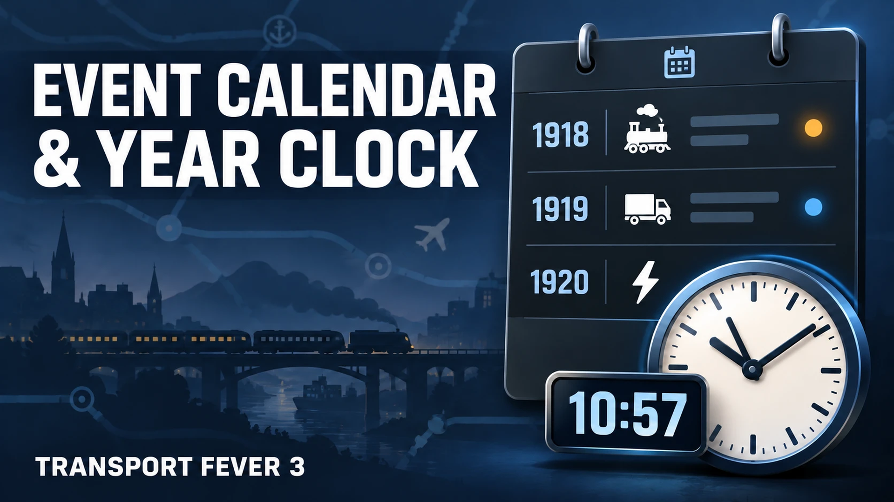
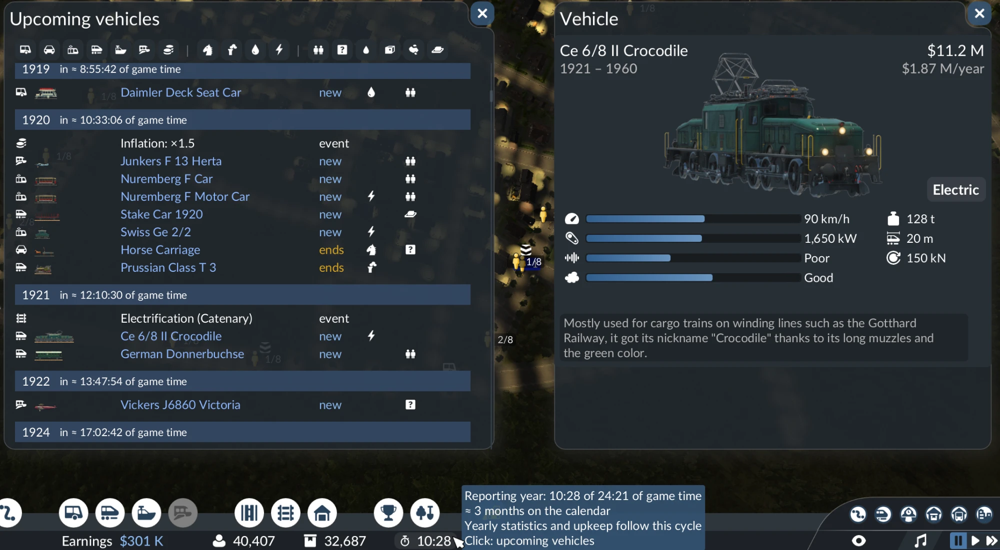

# [NJ] Event Calendar & Year Clock

A Transport Fever 3 mod: a reporting-period clock in the bottom bar and a calendar of all vehicles that will appear in or leave the vehicle store.





Author: [rushked](https://mod.io/u/rushked/). Available in the game's mod browser and on [mod.io](https://mod.io/g/transportfever3/m/nj-event-calendar-year-clock); a manual-install archive is on [Nexus Mods](https://www.nexusmods.com/transportfever3/mods/16).

## Features

- **Reporting-period clock** in the bottom bar, next to Earnings. The game's yearly statistics and upkeep follow a fixed cycle of game time (24:21 min at calendar speed 1x), not the calendar; the clock shows how far the current cycle has run, and its tooltip shows the calendar date when the next one starts.
- **Event calendar** (click the clock): every vehicle and multiple unit that appeared in or left the store since the game started and will do so later, grouped by year, with the game time left until each future year at the current calendar speed. Past years stay in the list, dimmed; the window opens at the current year.
  - Columns: vehicle type, picture (as in the store list), model, status (new / leaves the store), engine (horse, steam, diesel, electric), cargo specialization (the game's cargo class icons).
  - Filters by vehicle type, engine and specialization (any value within a group, all groups combined).
  - Milestones: inflation steps of construction costs and the arrival of catenary.
  - Click a model to open the same vehicle details as in the vehicle store.
- **All 13 game languages**: de, en, es, fr, it, ja, ko, nl, pl, pt_BR, ru, zh_CN, zh_TW.

## Compatibility

- Replaces no vanilla GUI recipe. The clock is a plugin of the official `GameBarInfoDisplayExtension`; the windows are the mod's own.
- No game script and nothing stored in the savegame: the mod can be added to or removed from an existing savegame.
- The vehicle details window uses a copy of the vehicle store's info block (see *Third-party code*); a game update may require updating that copy.

## Installation

Subscribe in the game's mod browser (mod.io). Manual install: put the `nj_event_calendar_1` folder from the [Nexus Mods](https://www.nexusmods.com/transportfever3/mods/16) archive (or `mod/nj_event_calendar_1` from this repository) into the game's user mods folder, e.g. `Steam/userdata/<your id>/3493540/local/mods/nj_event_calendar_1`, restart the game and enable the mod for your savegame.

## Repository layout

```
mod/nj_event_calendar_1/                the mod as installed
  mod.json, _content.json              mod definition; _content.json lists every file under content/
  _metadata/modinfo.json, 0.png        name, description, author, tags; cover image
  strings.json                         translations of the modinfo texts (language -> English text -> translation)
  content/gui/release_calendar/
    clock_plugin.{res.lua,script.tl}   the clock (GameBarInfoDisplayExtension plugin)
    calendar_window.tl                 the event calendar and vehicle details windows
    vehicle_details.tl                 copy of the vehicle store's info block
    i18n.tl                            UI strings in all game languages, language detection
    release_calendar.css.lua           styles
    icons/engine_*@2x.tga              engine icons (36 x 36, gray channel as alpha)
  tealdef/                             Teal type definitions of the mod
media/                                 screenshots for this README and the mod.io gallery
tools/
  make_engine_icons.py                 draws the engine icons (Pillow)
  test_release_calendar_i18n.lua       checks the UI strings: languages, placeholders, language detection
  tlrun.lua                            loads .tl modules in plain Lua for the test
```

## Development

The mod is written in [Teal](https://github.com/teal-language/tl) (typed Lua), like the game's own GUI.

- Test of the UI strings (needs Lua 5.4 and Teal: `luarocks install tl`):
  `lua5.4 tools/test_release_calendar_i18n.lua`
- Engine icons (needs Pillow): `python3 tools/make_engine_icons.py [preview.png]`
- After adding or removing a file under `content/`, update `_content.json`. New files are only picked up after a full game restart.
- When changing the name, summary or description in `_metadata/modinfo.json`, update the keys in `strings.json` too: they are the exact English texts.

## Third-party code

- `content/gui/release_calendar/vehicle_details.tl` contains recipes copied from the game's `gui/line_vehicle_mgmt/vehicle_store_window.tl` (Transport Fever 3, © Urban Games) so that the vehicle details look exactly like in the store. They belong to their owner.

## License

[MIT](LICENSE), except `vehicle_details.tl` (see *Third-party code*): the code copied from the game belongs to Urban Games and is not covered by this license.
